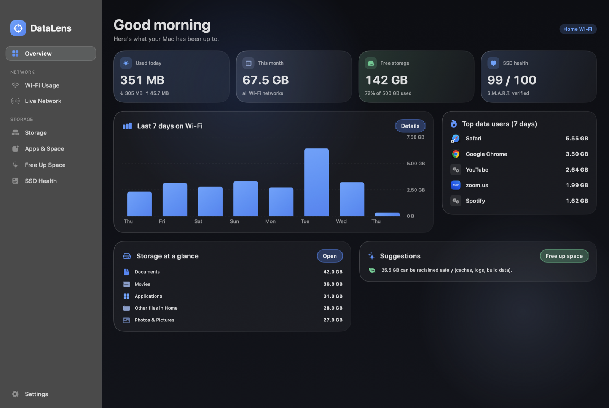
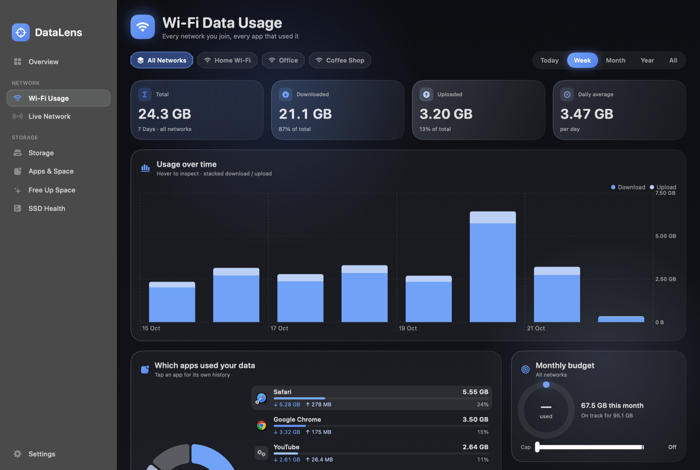
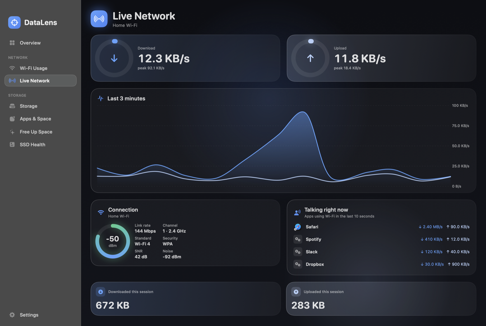
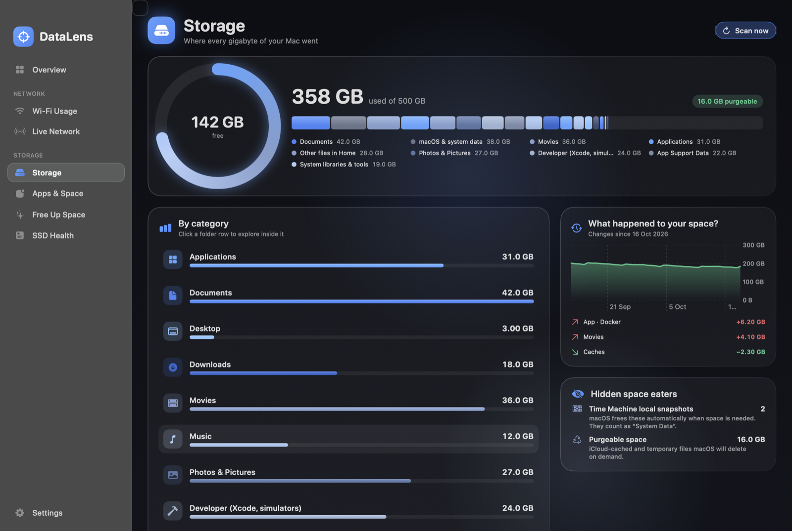
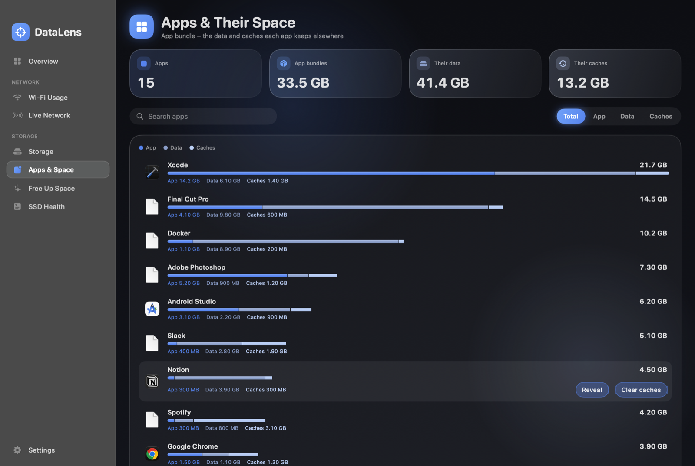
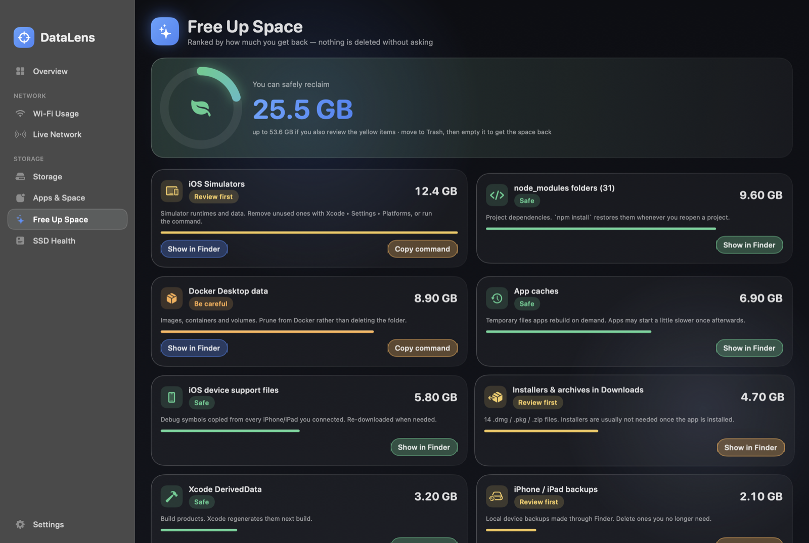
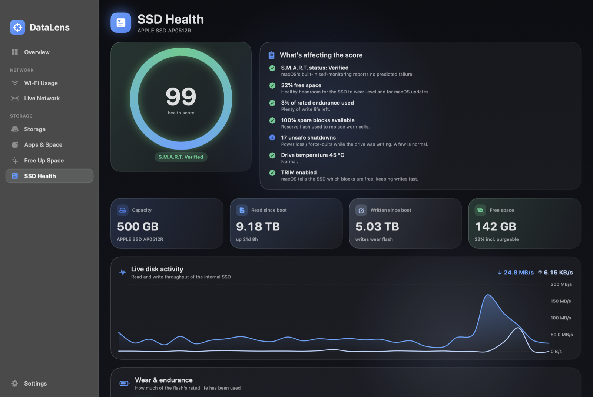

# DataLens

A native macOS app (SwiftUI + Swift Charts) that shows where your **Wi-Fi data** and your **disk space** go.

## Screenshots

Shown with demo data, not real usage.

| | |
|---|---|
|  **Overview** |  **Wi-Fi usage per network and app** |
|  **Live network** |  **Storage breakdown** |
|  **Apps and their space** |  **Free up space** |
|  **SSD health** | |

## Features

**Network**
- Data usage per Wi-Fi network (by SSID) for 24 h / 7 d / 30 d / 12 months / all time
- Per-app breakdown, hourly heatmap, monthly budget ring, auto-generated insights
- Live up/down speed, signal details, apps talking right now, menu-bar readout

**Storage**
- Used-space breakdown by category, clickable treemap folder explorer
- Per-app footprint (app + data + caches), free-space history, "what grew since last scan"
- Free-up suggestions (caches, Xcode, simulators, `node_modules`, installers, big files). Nothing is deleted without a confirmation, and files go to the Trash.

**SSD health**
- S.M.A.R.T. status, health score, live read/write throughput, speed test
- Wear counters (TB written, % life used) if [`smartmontools`](https://www.smartmontools.org) is installed

## Install

1. Download **DataLens-1.0.0.dmg** from the [latest release](https://github.com/pasinduPrabhath/DataLens/releases/latest) (macOS 14+, Apple Silicon and Intel).
2. Open it and drag **DataLens** into **Applications**.
3. The app is not notarized by Apple (no paid developer account), so the first launch is blocked. Either:
   - open **System Settings → Privacy & Security** and click **Open Anyway**, or
   - run `xattr -dr com.apple.quarantine /Applications/DataLens.app` in Terminal.

Then allow **Location** when asked and turn on **Start at login** in Settings.

## Build from source

Needs Xcode (or the Swift 5.9+ toolchain).

```bash
git clone https://github.com/pasinduPrabhath/DataLens.git
cd DataLens
./build.sh --install        # universal build, copied to /Applications
./scripts/make_dmg.sh       # optional: package build/DataLens-<version>.dmg
```

To try it with sample data instead of your own: `DATALENS_DEMO=1 .build/release/DataLens` (after `swift build -c release`).

## Permissions

- **Location Services**: macOS only reveals the Wi-Fi name to apps with this permission. Location itself is never read.
- Everything else works without extra permissions.

## How it works & limits

- Per-network totals come from the Wi-Fi interface counters (every 2 s); per-app numbers from `nettop` (every 10 s), so very short-lived processes can be missed.
- Tracking starts the first time DataLens runs and only while it runs. Enable **Start at login** in Settings. macOS keeps no per-network history to import.
- Wi-Fi only; Ethernet traffic is not counted.
- All data stays local in `~/Library/Application Support/DataLens`.

## Contributing

Issues and pull requests are welcome. See [CONTRIBUTING.md](CONTRIBUTING.md).

## License

MIT
